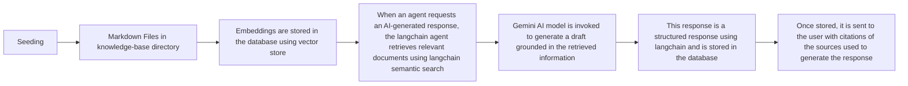

# QuickDesk

## Overview

Quickdesk is an AI assisted ticket support system. It helps agent solves support ticket faster by having AI providing response from the Knowledge-base. It is used by employees and support agent. Employees can create tickets and once created, it is give AI specific category and priority, then Agent can change the category and priority if needed and can use the AI provided response to resolve the ticket. Employees receive real-time notifications for the ticket which are being resolved by the agent and agent also receives real-time notifications for the ticket which are being created by the employee.

## Prerequisites

- Python 3.14 or later
- Node.js and npm
- Docker and docker-compose
- uv
- git
- Google Gemini API key

## Local Setup

### 1. Clone the repository

```bash
git clone https://github.com/sKalathiya/quickdesk.git
cd quickdesk
```

### 2. Configure the environment variables

There are two environment files in the root directory:
`.env` file for docker compose
`quickdesk-backend/.env` file for the quickdesk backend

The root `.env` should contain the PostgreSQL values used by Docker Compose. The backend `.env` needs those same database credentials, plus `JWT_SECRET_KEY`, `JWT_ALGORITHM`, `JWT_EXPIRATION_TIME`, and `GOOGLE_API_KEY`.

### 3. Start the database

```bash
docker compose up -d
docker compose ps # to check if the database is running
```

### 4. Install backend dependencies

```bash
cd quickdesk-backend
uv sync
```

### 5. Start the Backend

```bash
uv run fastapi dev app/main.py
```

Once the backend is running, you can access the API at `http://localhost:8000`.

### 6. Seed the backend database

```bash
uv run app.core.seed
```

This will seed the database with the default users and roles.

### 7. Start the frontend

```bash
cd quickdesk-frontend
npm install
npm run dev
```

Once the frontend is running, you can access the application at `http://localhost:5173`.

## Architecture

Quickdesk consists of two main components: the fastapi backend and the react frontend. The postgres database with pgvector extension is hosted in a docker container. The backend is responsible for the business logic and the frontend is responsible for the user interface.

## System Architecture

```text
                        QUICKDESK
                    System Architecture

                     +------------------+
                     |      USERS       |
                     | Employee / Agent |
                     +------------------+
                              |
                              v
+-----------------------------------------------------------+
|                   REACT FRONTEND                          |
|                                                           |
|  Employee Dashboard  |  Agent Dashboard  |  Metrics        |
|  TanStack Query      |  Notifications    |  Toasts         |
+-----------------------------------------------------------+
             |                              ^
             | REST API                     | SSE
             v                              |
+-----------------------------------------------------------+
|                       FASTAPI                             |
|                                                           |
|  Authentication & RBAC                                    |
|  Ticket Management      |  Agent Metrics & Audit Logs     |
|  AI Classification      |  RAG Reply Generation          |
|  SSE Notification Manager                                 |
+-----------------------------------------------------------+
               |                         |
               v                         v
+---------------------------+  +----------------------------+
|        POSTGRESQL         |  |       GOOGLE GEMINI        |
|                           |  |                            |
|  Users                    |  |  Ticket Classification     |
|  Tickets                  |  |  AI Resolution Drafts      |
|  Agent Audit Logs         |  |  Document Embeddings       |
|  pgvector Embeddings      |  |                            |
+---------------------------+  +----------------------------+
               ^
               |
+---------------------------+
|       KNOWLEDGE BASE      |
|                           |
|  Local Markdown Articles  |
|  Document Ingestion       |
+---------------------------+
```

### Architecture Overview

QuickDesk follows a client-server architecture with a React and TypeScript frontend, a FastAPI backend, and PostgreSQL for persistent storage.

**Frontend:** Provides separate interfaces for employees and support agents. It communicates with the backend through REST APIs, manages server state using TanStack Query, and receives real-time notifications through Server-Sent Events (SSE).

**Backend:** Handles authentication, role-based authorization, ticket creation and management, agent updates, audit logging, and dashboard metrics. It also integrates with Google Gemini for automated ticket classification and AI-assisted resolution drafting.

**Database:** PostgreSQL stores user accounts, tickets, and agent activity logs. The pgvector extension stores knowledge-base embeddings for semantic similarity search.

**AI and Knowledge Base:** Local Markdown documents are loaded into the knowledge base and embedded using Google's embedding model. When an agent requests an AI-generated response, the backend retrieves relevant documents and uses Gemini to generate a draft grounded in the retrieved information.

**Real-Time Notifications:** The FastAPI backend publishes SSE notifications when tickets are created or resolved. The frontend displays toast notifications and invalidates relevant TanStack Query caches to refresh ticket information.

### Ticket lifecycle

Ticket is created by an employee and on receving in backend it is stored in databaase and ai request is made to generate classificaiotn. Its failure does not reverse the ticket creation. once done, an inmemory connection map is used to signal the cretion to every logged in agent having SSE connection to the backend. Agent can then change status, priority and category if needed. It will create logs for each change made by the agent. Once ready to resolve, agent can click on resolve button and generate ai draft which they can use or change and submit resolve. Once updated in database again connection map is used to signal the resolution to the employee.

```mermaid
flowchart LR
    A[Employee Creates Ticket] --> B[AI Generates Classification]
    B --> C[In-Memory Connection Map]
    C --> D[Agent Receives Notification]
    D --> E[Agent Changes Status, Priority, Category]
    E --> F[Agent Generates AI Draft]
    F --> G[Agent Submits Resolve]
    G --> H[In-Memory Connection Map]
    H --> I[Employee Receives Notification]
    I --> J[Ticket Resolved]
```



### RAG Architecture

On seeding, langchain uses markdown files in the `knowledge-base` directory and embeds them using the Google Gemini API. These embeddings are stored in the database using vector store and used to generate responses for the tickets. When an agent requests an AI-generated response, the langchain agent retrieves relevant documents using langchain semantic search and invokes Gemini AI model to generate a draft grounded in the retrieved information. This response is a structured response using langchain and is stored in the database. Once stored, it is sent to the user with citations of the sources used to generate the response.



## API Endpoints

**Base URL:** `http://localhost:8000/api/v1`

QuickDesk uses JWT authentication with HTTP-only cookies. Protected endpoints require an authenticated session, and role-based permissions are enforced by the FastAPI backend.

### Authentication and User Management

| Method | Endpoint                  | Purpose                                                | Authentication |
| ------ | ------------------------- | ------------------------------------------------------ | -------------- |
| POST   | `/auth/register`          | Register a new employee account                        | Public         |
| POST   | `/auth/login`             | Authenticate a user and issue a JWT cookie             | Public         |
| POST   | `/auth/logout`            | Revoke the session and clear the authentication cookie | Authenticated  |
| GET    | `/users/current-user`     | Retrieve the current user's profile                    | Authenticated  |
| GET    | `/users/dashboard`        | Retrieve ticket metrics and performance statistics     | Agent only     |
| GET    | `/users/logs/{ticket_id}` | Retrieve the audit history of ticket changes           | Agent only     |

### Ticket Management

| Method | Endpoint                             | Purpose                                                                | Authentication |
| ------ | ------------------------------------ | ---------------------------------------------------------------------- | -------------- |
| POST   | `/tickets/`                          | Create a support ticket with title, description, and optional filename | Employee only  |
| GET    | `/tickets/`                          | Retrieve a paginated list of tickets with optional filters             | Authenticated  |
| GET    | `/tickets/{ticket_id}`               | Retrieve information about a specific ticket                           | Authenticated  |
| PUT    | `/tickets/agent/update/{ticket_id}`  | Update ticket category and priority                                    | Agent only     |
| POST   | `/tickets/agent/{ticket_id}/answer`  | Generate an AI-assisted resolution draft using the knowledge base      | Agent only     |
| PUT    | `/tickets/agent/resolve/{ticket_id}` | Resolve a ticket with the agent's final response                       | Agent only     |

**Ticket listing filters:**

| Query Parameter | Description                  | Accepted Values                                          |
| --------------- | ---------------------------- | -------------------------------------------------------- |
| `page`          | Page number, starting from 1 | Positive integer                                         |
| `page_size`     | Number of tickets per page   | 1–100                                                    |
| `status`        | Filter by ticket status      | `OPEN`, `RESOLVED`                                       |
| `category`      | Filter by ticket category    | `IT`, `HR`, `FINANCE`, `ADMIN`, `OTHER`, `NOT_SPECIFIED` |
| `priority`      | Filter by ticket priority    | `LOW`, `MEDIUM`, `HIGH`, `NOT_SPECIFIED`                 |
| `title`         | Search tickets by title      | Text                                                     |

**Access behavior:**

- Employees can view only their own tickets.
- Agents can view all tickets.
- Category and priority modifications are restricted to agents.
- Ticket resolution is restricted to agents.

### Real-Time Notifications

| Method | Endpoint                         | Purpose                                    | Authentication |
| ------ | -------------------------------- | ------------------------------------------ | -------------- |
| GET    | `/notifications/agent/stream`    | Receive real-time ticket creation events   | Agent only     |
| GET    | `/notifications/employee/stream` | Receive real-time ticket resolution events | Employee only  |

**SSE event types:**

| Event             | Recipient        | Purpose                                           |
| ----------------- | ---------------- | ------------------------------------------------- |
| `TICKET_CREATED`  | Connected agents | Notify agents when a new ticket is created        |
| `TICKET_RESOLVED` | Ticket owner     | Notify the employee when their ticket is resolved |

The frontend listens for Server-Sent Events (SSE) and invalidates the relevant TanStack Query caches to update ticket lists and metrics.

### Interactive API Documentation

FastAPI automatically generates interactive API documentation:

- **Swagger UI:** `http://localhost:8000/docs`

These endpoints are available when the backend development server is running.

## Design Decisions and Tradeoffs

### Why React instead of Next.js?

I chose React because it is a mature and widely used library for building user interfaces. It is also easy to learn and use. I have used it in the past and I am comfortable with it. Next.js is a great library for building server-side rendered applications and SEO friendly applications. But I wanted to keep the application simple and lightweight and also it was for internal company use. I do not get file based routing and rich features of full stack frameworks like Next.js but it was not needed for this application.

### How did you structure the RAG pipeline? Chunk size, embedding model, retriever, prompt?

I started with langchain for emebedding and vectore store. Then I used langchain semantic search to retrieve the relevant documents. Then I used Gemini AI model to generate a draft grounded in the retrieved information. I selected the whole article as a chunk just because the article was small and it only explained one topic. There was no separate topics independent of each other and as such If I were to chunk it, it would have lost the context. I used Google's gemini-embedding-001 model to generate document embeddings and stored them in PostgreSQL using pgvector. For retrieval, I used LangChain's similarity search to find relevant knowledge-base documents. The retrieved information is then provided to a Gemini-powered LangChain agent, which generates a draft response grounded in the knowledge base. I tried with multiple prompts and found the one that worked best for the application. I added this prompt with a lot of restrictions and clear instructions to the agent.

### How did you handle the case where the LLM returns a category that does not match your allowed list?

I use langchain strucuted response for handling this. I added pydantics model as a strucuted response and if model generates a category that does not match the allowed list, pydantic raises an error and the ai category and priority are not stored in the database. By default, it will use the default category and priority. I did not want to retry this process as agent can eventually change the category and priority if needed.

### Where did you store the JWT on the client, and why?

I stored the JWT in the HTTP-only cookie. This is a secure way to store the JWT and it is not accessible to the client side scripts. It is also a small and lightweight way to store the JWT. The reasons for not using local storage is that it is not secure and anyone can access it. The browser automatically includes the cookie in eligible API requests, so the frontend does not need to manually read or attach the JWT. I chose this approach because it reduces client-side token exposure while allowing the FastAPI backend to validate authentication and enforce authorization for protected endpoints.

### How did you enforce role-based access on the backend? What stops an employee from hitting an agent-only endpoint by guessing the URL?

I enforced it by adding the role in jwt token and checking it in the backend. This is a simple and effective way to enforce role-based access. It also stops an employee from hitting an agent-only endpoint by guessing the URL. As they would not have the token to access the endpoint. They cannot create the token as we have the secret key to sign the token which is not known to them.

### Why did you pick SSE for real-time? What is the failure mode if the socket disconnects mid-session?

I chose Server-Sent Events (SSE) because QuickDesk only requires one-way communication from the server to the client to notify agents when tickets are created and employees when tickets are resolved. SSE is simpler and has less overhead than WebSockets for this use case. It also supports automatic reconnection through the browser's EventSource API. However, if the connection drops, notifications sent while the client is disconnected may be lost because the current implementation stores events in memory without persistence or replay. The client can reconnect and refresh ticket data, but missed notifications cannot be recovered.

### What is the worst failure mode in your system today, and what would you do to address it?

The worst failure mode in the system today is if the connection drops mid-session. This can cause the agent to miss notifications and the employee to not receive notifications. This is a critical issue as the agent may not know about the ticket and the employee may not know about the resolution.
To address this, I would introduce a persistent notifications system using a message queue so that it can be scalable and it can deliver notifications to the user who were disconnected from the backend. This would ensure that the notifications are not lost and the user can receive them even if they are disconnected from the backend.

### Where did AI tools help you most? Where did they hurt or mislead you?

AI tools helped me primarily with frontend development, especially building UI components, improving layouts, styling, and speeding up repetitive tasks. They also helped with debugging and understanding unfamiliar errors. However, AI occasionally suggested incorrect implementations, outdated approaches, or unnecessary complexity. I learned not to blindly trust AI-generated code and to verify suggestions through documentation, testing, and manual review. I added project instructions to always use the latest version of the library and to use the latest features and updates.

## Known Issues / Limitations

### 1. SSE Notifications

SSE notifications are managed in in-memory connection map. This is not a scalable solution and should be replaced with a more scalable solutions. Also, it does not deliver notifications to the user who were disconnected from the backend. It only provides live notifications to the user who are currently connected to the backend.

### 2. AI Response Reliability

AI response grounding can be further improved by using a grader model which can grade the response based on the context and the response.

### 3. AI Response Time

AI response time can be further improved by using a more powerful model and by using a more efficient embedding model.

### 4. Logging

Logging is not implemented in the backend.

### 5. Testing

Testing is not fully implemented in the backend and frontend.

### What I Would Do With More Time

I would prioritize improvements based on reliability, security, answer quality, and maintainability.

- Introduce persistent notifications system using a message queue so that it can be scalable and it can deliver notifications to the user who were disconnected from the backend.
- Implement a grader model which can grade the response based on the context and the response.
- Implement a redis queue for the backend to handle the long running tasks like embedding generation and AI response generation.
- Implement a more robust logging system.
- Implement more rate limiting and throttling.
- Improve RAG accuracy and reliability.
